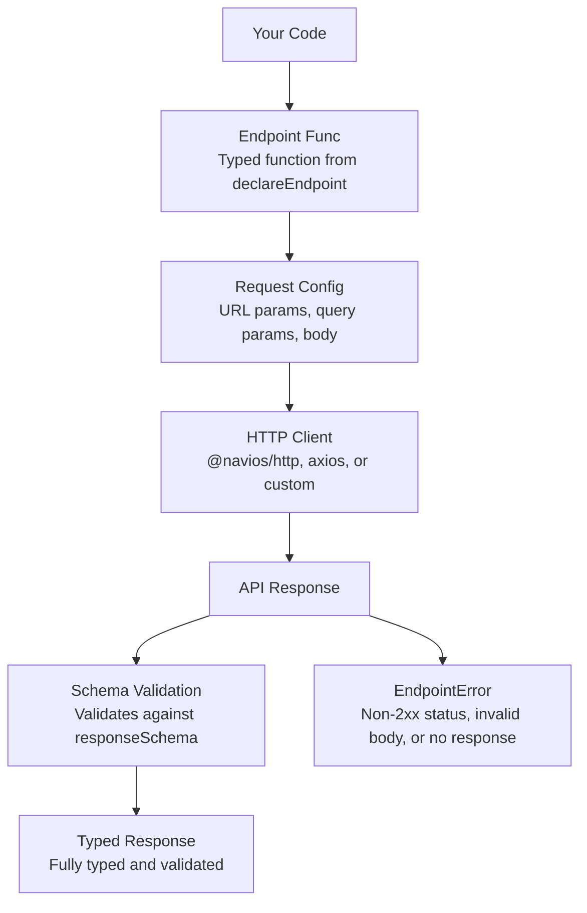

# Overview

`@navios/builder` is a type-safe HTTP API client builder for TypeScript. It provides a declarative way to define API endpoints with full schema validation for requests, responses, and URL parameters. The documentation uses Zod; any library that implements [Standard Schema](https://standardschema.dev) (Valibot, ArkType, ...) works in its place.

**Package:** `@navios/builder`  
**License:** MIT  
**Peer Dependencies:** `zod` (^3.25.0 || ^4.0.0)

## Why Use Builder?

### Type Safety

Builder provides end-to-end type safety from your API definitions to your application code:

- **URL Parameters**: Automatically extracted and typed from `$paramName` syntax
- **Request Bodies**: Validated and typed using schemas
- **Response Data**: Validated at runtime and typed at compile time
- **Query Parameters**: Full type safety with schema validation

### Runtime Validation

All data is validated at runtime using schemas:

- Invalid requests are caught before sending
- Invalid responses are caught and reported
- Type mismatches are detected early

### Declarative API

Define your API once in a clear, declarative way:

```typescript
const getUser = API.declareEndpoint({
  method: 'GET',
  url: '/users/$userId',
  responseSchema: userSchema,
})
```

### Flexible HTTP Clients

Works with any HTTP client that implements the `Client` interface:

- `@navios/http` (recommended)
- `axios`
- Custom clients, including a thin `fetch` wrapper

### Error Handling

One error model for every failure:

- **`EndpointError`** - a single error class with a `kind` (`http`, `network`, `timeout`, `request-validation`, ...) to switch on
- **Two call styles** - `endpoint()` throws, `endpoint.safe()` returns `{ ok, data, error, response }`
- **Error schema** - map HTTP status codes to schemas for typed `error.body`
- **`onError` hook** - one place to report every failed call

## Core Concepts

### Builder Pattern

The builder creates a centralized API definition that:

- Declares typed endpoints with request/response schemas
- Holds the HTTP client the endpoints use
- Classifies every failure into an `EndpointError`
- Supports JSON, blob, text, stream and empty responses, and multipart uploads

### Type Safety

- **URL Parameters**: Extracted from `$paramName` syntax and enforced at the type level
- **URL Parameter Validation**: Optional `urlParamsSchema` for runtime validation
- **Request Bodies**: Validated against their schema before sending
- **Response Data**: Validated and typed automatically
- **Query Parameters**: Full schema validation support
- **Error Responses**: Type-safe error handling with `errorSchema`
- **Per-Status Responses**: A `responses` map for endpoints whose 2xx replies differ by status

### Schema Validation

All data flows through schemas:

- Request validation ensures data matches expected shape
- Response validation catches API contract violations
- Type inference provides full TypeScript support
- Any Standard Schema v1 library can supply a schema, and libraries can be mixed within one endpoint — see [Other Schema Libraries](/docs/builder/builder/guides/schemas#other-schema-libraries)

## Architecture



## Key Features

### URL Parameter Extraction

```typescript
const getUser = API.declareEndpoint({
  method: 'GET',
  url: '/users/$userId/posts/$postId',
  responseSchema: postSchema,
})

// TypeScript enforces both parameters
await getUser({
  urlParams: {
    userId: '123',    // ✅ Required
    postId: '456',    // ✅ Required
  },
})
```

### URL Parameter Validation

Validate URL parameters at runtime with `urlParamsSchema`:

```typescript
const getUser = API.declareEndpoint({
  method: 'GET',
  url: '/users/$userId',
  responseSchema: userSchema,
  urlParamsSchema: z.object({
    userId: z.string().uuid(), // Must be a valid UUID
  }),
})
```

### Request/Response Validation

```typescript
const createUser = API.declareEndpoint({
  method: 'POST',
  url: '/users',
  requestSchema: z.object({
    name: z.string().min(1),
    email: z.string().email(),
  }),
  responseSchema: userSchema,
})

// Request is validated before sending
// Response is validated after receiving
const user = await createUser({
  data: { name: 'John', email: 'john@example.com' },
})
```

### Throwing and Safe Calls

```typescript
// Throws an EndpointError on any failure
const user = await getUser({ urlParams: { userId: '123' } })

// Never throws
const result = await getUser.safe({ urlParams: { userId: '123' } })
if (result.ok) {
  console.log(result.data.name, result.response.status)
} else {
  console.error(result.error.kind)
}
```

### Uploads and Non-JSON Responses

```typescript
// Multipart upload
const uploadFile = API.declareEndpoint({
  method: 'POST',
  url: '/files',
  body: 'multipart',
  requestSchema: z.object({ file: z.instanceof(File) }),
  responseSchema: z.object({ id: z.string() }),
})

// Blob download
const downloadFile = API.declareEndpoint({
  method: 'GET',
  url: '/files/$fileId',
  response: 'blob',
})

// No response body (204)
const deleteFile = API.declareEndpoint({
  method: 'DELETE',
  url: '/files/$fileId',
  response: 'void',
})
```

`response` also accepts `'text'` and `'stream'`.

### Error Schema

Give error responses a type by mapping HTTP status codes to Zod schemas:

```typescript
const getUser = API.declareEndpoint({
  method: 'GET',
  url: '/users/$userId',
  responseSchema: userSchema,
  errorSchema: {
    400: z.object({ error: z.string(), field: z.string() }),
    404: z.object({ error: z.literal('Not Found') }),
  },
})

const result = await getUser.safe({ urlParams: { userId: '123' } })

if (result.ok) {
  console.log('User:', result.data.name)
} else if (result.error.kind === 'http' && result.error.status === 404) {
  console.log('Not found:', result.error.body.error)
} else if (result.error.kind === 'http' && result.error.status === 400) {
  console.log('Bad request:', result.error.body.error, result.error.body.field)
}
```

### Global Error Hook

Register an `onError` hook for cross-cutting concerns. It is called once for every failed call with the `EndpointError` the caller receives:

```typescript
const API = builder({
  client,
  onError: (error) => {
    if (error.kind === 'request-validation' || error.kind === 'response-validation') {
      logValidationError(error.endpoint, error.issues)
    } else if (error.kind === 'network' || error.kind === 'timeout') {
      logNetworkFailure(error.cause)
    } else {
      logHttpError(error.endpoint, error.status, error.body)
    }
  },
})
```

### Per-Endpoint Configuration

Set headers, a timeout and client-specific options per endpoint:

```typescript
const createUser = API.declareEndpoint({
  method: 'POST',
  url: '/users',
  requestSchema: createUserSchema,
  responseSchema: userSchema,
  headers: { 'X-Custom-Header': 'value' },
  timeout: 30000,
  clientOptions: { withCredentials: true },
})
```

### Per-Call Client

Pass a client as the second argument to use it for one call — for example a per-request client during server-side rendering:

```typescript
const user = await getUser({ urlParams: { userId: '123' } }, { client: requestClient })
```

## Quick Start

```typescript
import { builder } from '@navios/builder'
import { create } from '@navios/http'
import { z } from 'zod'

// 1. Create a builder instance with an HTTP client
const API = builder({
  client: create({ baseURL: 'https://api.example.com' }),
})

// 2. Define your schemas
const userSchema = z.object({
  id: z.string(),
  name: z.string(),
  email: z.string().email(),
})

// 3. Declare endpoints
export const getUser = API.declareEndpoint({
  method: 'GET',
  url: '/users/$userId',
  responseSchema: userSchema,
})

export const createUser = API.declareEndpoint({
  method: 'POST',
  url: '/users',
  requestSchema: userSchema.omit({ id: true }),
  responseSchema: userSchema,
})

// 4. Use the endpoints
const user = await getUser({ urlParams: { userId: '123' } })
const newUser = await createUser({ data: { name: 'John', email: 'john@example.com' } })
```

## What's Next?

- [Getting Started](/docs/builder/builder/getting-started) - Installation and setup guide
- [Defining Endpoints](/docs/builder/builder/guides/defining-endpoints) - Learn how to declare endpoints
- [URL Parameters](/docs/builder/builder/guides/url-parameters) - Understand URL parameter handling
- [Request & Response Schemas](/docs/builder/builder/guides/schemas) - Zod schema patterns and other schema libraries
- [Error Handling](/docs/builder/builder/guides/error-handling) - Handle errors gracefully
- [API Reference](/docs/builder/builder/api-reference) - Complete API documentation

