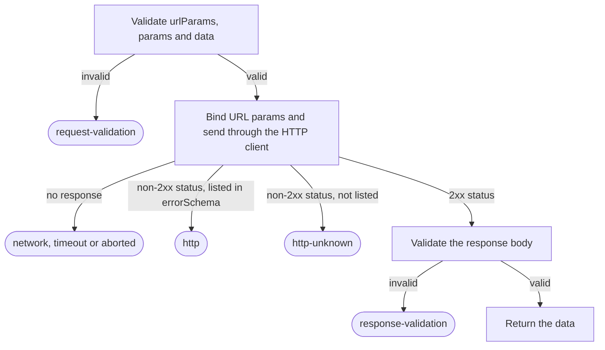

# How it works

Builder has a small model: a declaration is plain data, and `declareEndpoint` wraps it in a function. This page describes what that function does on every call, so the rest of the docs can refer to it instead of repeating it.

## A declaration is data plus a function

```ts
const getUser = API.declareEndpoint({
  method: 'GET',
  url: '/users/$userId',
  responseSchema: userSchema,
})

getUser.config // the options object above, unchanged
await getUser({ urlParams: { userId: '42' } }) // throws on failure
await getUser.safe({ urlParams: { userId: '42' } }) // never throws
```

Because the options stay readable on `config`, other tools can consume a declaration without calling it. That is how a Navios server controller knows which route to register and how `@navios/react-query` builds cache keys.

## What happens during a call



Four things follow from this pipeline:

- **Invalid input never leaves the process.** `urlParams`, `params` and `data` are validated first. A failure there produces an error without touching the network.
- **What you pass is what is sent.** The schemas decide whether a request leaves; they do not rewrite it. Defaults and transforms run where the request is parsed. [What is sent](/docs/builder/essentials/inputs#what-is-sent) explains this, and the option to send the schemas' output.
- **Builder decides what is an error, not the HTTP client.** Any status outside 200–299 is a failure, whether the client resolved or rejected. This is why a bare `fetch` wrapper works as a client.
- **Every failure is the same type.** Each rounded box in the diagram is an `EndpointError`, and its label is the error's `kind`. [Errors](/docs/builder/essentials/errors) covers them in full.

## Two ways to call

Both forms run the same pipeline and produce the same error for the same failure. They differ only in how the failure reaches you.

```ts
// Throwing form: resolves to the data
const user = await getUser({ urlParams: { userId: '42' } })

// Safe form: resolves to a SafeResult
const res = await getUser.safe({ urlParams: { userId: '42' } })
if (res.ok) {
  res.data // the user
  res.response // { status, statusText, headers }
} else {
  res.error // EndpointError
  res.response // ResponseMeta, or null when nothing came back
}
```

Use the **throwing form** when a failure should abort what you are doing and something above you handles it: a server request handler, a React Query hook, a script.

Use the **safe form** when a failure is one of the expected outcomes and you want the compiler to make you look at it: a form that shows a "name already taken" message, a lookup where 404 means "create it". Inside the `else` branch the error is fully typed, including the body of each status you declared. In a `catch` block the value is `unknown` and you need [guards](/docs/builder/essentials/errors#in-a-catch-block) to get that back.

## Where the types come from

Nothing is annotated by hand. `declareEndpoint` infers one type per part of the declaration:

| Part of the call         | Inferred from                                                        |
| ------------------------ | -------------------------------------------------------------------- |
| `urlParams` keys         | the `$name` placeholders in `url`                                    |
| `urlParams` value types  | `urlParamsSchema`, or `string \| number` without one                  |
| `params`                 | the **input** type of `querySchema`                                  |
| `data`                   | the **input** type of `requestSchema`                                |
| resolved value           | the **output** type of `responseSchema` (or the `response` kind)     |
| `error.body` per status  | the **output** type of each `errorSchema` entry                      |

Input and output differ when a schema transforms or applies defaults. You pass what the schema accepts and receive what it produces. [Schemas](/docs/builder/essentials/schemas#input-and-output-types) has the details.

To name these types elsewhere in your code, use the [type helpers](/docs/builder/essentials/endpoints#type-helpers) rather than re-deriving them from the schemas.
