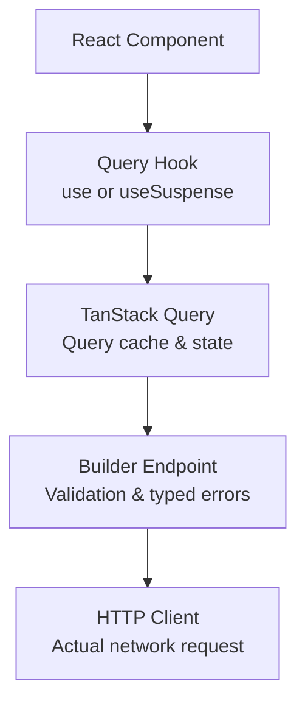

# Overview

`@navios/react-query` is a type-safe React Query integration that bridges TanStack Query v5 with the `@navios/builder` API client. You declare an endpoint once and get hooks, cache keys and cache helpers that are typed from its Zod schemas.

**Package:** `@navios/react-query`  
**License:** MIT  
**Peer Dependencies:** `@navios/builder`, `@tanstack/react-query` (^5.102.0), `zod` (^3.25.0 || ^4.0.0)

## The Client

`declareClient` returns three factories. Each one accepts either an inline endpoint declaration or an endpoint already declared with `api.declareEndpoint`:

```typescript
import { builder } from '@navios/builder'
import { create } from '@navios/http'
import { declareClient } from '@navios/react-query'

const api = builder({ client: create({ baseURL: 'https://api.example.com' }) })
const client = declareClient({ api })

client.query(/* ... */) // a query object
client.infiniteQuery(/* ... */) // an infinite query object
client.mutation(/* ... */) // a mutation hook
```

## Why Use It?

### Type Safety

- Arguments (`urlParams`, `params`, `data`) are typed from the endpoint
- Response data is typed from `responseSchema`
- Errors are typed from `errorSchema`
- Cache keys carry the data type, so `queryClient.getQueryData(getUser.key(args))` is typed too

### One Object per Endpoint

```typescript
const getUser = client.query({
  method: 'GET',
  url: '/users/$userId',
  responseSchema: userSchema,
})

getUser.use({ urlParams: { userId } }) // useQuery
getUser.useSuspense({ urlParams: { userId } }) // useSuspenseQuery
getUser({ urlParams: { userId } }) // query options for useQuery / useQueries
getUser.key({ urlParams: { userId } }) // cache key
await getUser.prefetch(queryClient, { urlParams: { userId } })
await getUser.invalidate(queryClient, { urlParams: { userId } })
```

### Errors in React Query's Error Channel

Queries and mutations call the throwing form of the endpoint. Every failure — an HTTP status, a validation failure, a network problem — is an `EndpointError` in `error`, so retries, `isError` and error boundaries behave as they do in plain TanStack Query:

```typescript
const { error } = getUser.use({ urlParams: { userId } })

if (error?.kind === 'http' && error.status === 404) {
  error.body // typed from errorSchema[404]
}
```

### Declarative Cache Updates

```typescript
const updateUser = client.mutation({
  method: 'PATCH',
  url: '/users/$userId',
  requestSchema: z.object({ name: z.string() }),
  responseSchema: userSchema,
  // Refetch after success
  invalidates: [listUsers],
  // Update the cache before the request is sent, roll back on failure
  optimistic: (update) =>
    update(getUser, {
      args: (variables) => ({ urlParams: variables.urlParams }),
      update: (current, variables) => current && { ...current, ...variables.data },
    }),
})
```

## Key Principles

- **Type-Safe** - End-to-end TypeScript support with Zod validation
- **Declarative** - Define API contracts once, reuse everywhere
- **Thin** - Every TanStack Query option is still available; the library only owns the key and the request function
- **Predictable Keys** - One key shape for every endpoint, with three invalidation scopes
- **Suspense Ready** - First-class React Suspense support

## Architecture



## Features

### Queries

```typescript
const { data, isPending, error } = getUser.use({ urlParams: { userId: '123' } })

const { data: user } = getUser.useSuspense({ urlParams: { userId: '123' } })
```

### Infinite Queries

```typescript
const listUsers = client.infiniteQuery({
  method: 'GET',
  url: '/users',
  querySchema: z.object({
    cursor: z.string().optional(),
    limit: z.number().optional(),
  }),
  responseSchema: z.object({
    users: z.array(userSchema),
    nextCursor: z.string().nullable(),
  }),
  getNextPageParam: (lastPage) =>
    lastPage.nextCursor ? { cursor: lastPage.nextCursor } : undefined,
})
```

### Mutations

```typescript
const createUser = client.mutation({
  method: 'POST',
  url: '/users',
  requestSchema: createUserSchema,
  responseSchema: userSchema,
  invalidates: [listUsers],
})

const { mutate, isPending } = createUser()
```

### Uploads and Downloads

Uploads and downloads use the same `client.mutation` and `client.query` factories; the endpoint declares the body or response kind:

```typescript
const uploadAvatar = client.mutation({
  method: 'POST',
  url: '/users/$userId/avatar',
  body: 'multipart',
  requestSchema: z.object({ file: z.instanceof(File) }),
  responseSchema: z.object({ url: z.string() }),
})

const downloadReport = client.mutation({
  method: 'GET',
  url: '/reports/$reportId',
  response: 'blob',
})
```

## What's Next?

- [Getting Started](/docs/builder/react-query/getting-started) - Installation and setup
- [Queries](/docs/builder/react-query/guides/queries) - Learn about queries
- [Mutations](/docs/builder/react-query/guides/mutations) - Learn about mutations
- [Query Keys](/docs/builder/react-query/guides/query-keys) - Understand query key management
- [Suspense](/docs/builder/react-query/guides/suspense) - Use Suspense for cleaner code
- [Optimistic Updates](/docs/builder/react-query/guides/optimistic-updates) - Update UI optimistically
