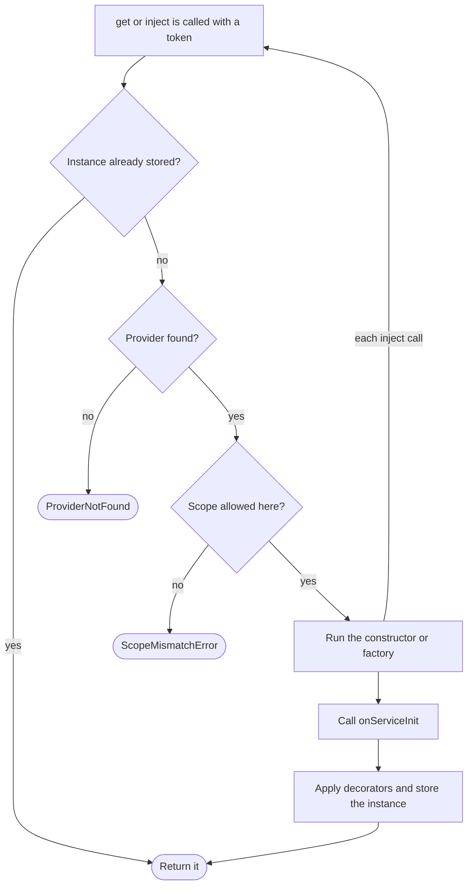

# How resolution works

The container has a small model: a token names a dependency, a provider says how to build it, and a container stores the instance. This page follows one `get()` call through that model, so the rest of the docs can refer to it instead of repeating it.

## Token, provider, instance

| Piece    | What it is                                                                                                                           | Where it lives                                    |
| -------- | ------------------------------------------------------------------------------------------------------------------------------------ | ------------------------------------------------- |
| Token    | The identity of a dependency. `@Injectable()` creates one for the class; `InjectionToken.create()` creates one for anything else     | On the class, or in a variable you export         |
| Provider | How to produce the value: a class to construct, a factory to call, or a ready value, plus a scope                                    | A default on the token; overrides on a container  |
| Instance | The value a provider produced                                                                                                        | In a container, keyed by token and arguments      |

Passing a class to `get()` or `inject()` is shorthand for passing its token. Tokens are compared by identity, never by name. [Tokens](/docs/di/essentials/tokens) and [Providers](/docs/di/essentials/providers) cover the two pieces you write yourself.

## What happens during a call



Three things follow from this pipeline:

- **Dependencies are discovered by running the constructor.** Nothing is declared ahead of time. An `inject()` call re-enters the same pipeline for its own token, which is why conditional `inject()` calls work: a dependency that this build does not ask for is not built.
- **The scope decides where the instance is stored.** A singleton goes to the root container, a request-scoped instance to the scope that asked, and a transient is not stored at all. [Scopes](/docs/di/essentials/scopes) has the rules.
- **Every failed resolution is a `DIError`** with a `code`. An error thrown by your constructor, factory or `onServiceInit` is wrapped as `InitializationError`, with the original in `cause`. A `DIError` raised while building a dependency passes through unchanged, so the error names the innermost service that failed. The [API reference](/docs/di/reference/api#error-codes) lists the codes.

While an instance is being built, the container records which stored instances it injected. [Invalidation](/docs/di/guides/invalidation) uses those links to destroy dependents together with the thing they depend on.

## Synchronous first

The whole pipeline runs synchronously. When `UserService` is constructed, `inject(DatabaseService)` constructs `DatabaseService`, runs its `onServiceInit` and returns the real, finished instance before the next field initialiser runs.

`get()` returns a promise so that one call works for every service. `getSync()` returns the instance directly, and succeeds whenever nothing on the way was asynchronous:

```ts
// DatabaseService and UserService come from the quick start
const users = container.getSync(UserService)
```

`peek()` never builds anything. It returns an instance that already exists, or `null`.

## When resolution becomes asynchronous

Resolution has to wait in these cases:

| Cause                                                                    | Example                                              |
| ------------------------------------------------------------------------ | ---------------------------------------------------- |
| `onServiceInit` returns a promise                                        | A service that opens a connection before it is ready |
| A factory returns a promise, or awaits `ctx.inject()`                    | `create()` that loads configuration                  |
| A [factory token](/docs/di/essentials/tokens#factory-tokens) whose function is async | Arguments read from a remote source      |
| The instance is being destroyed by an `invalidate()` that has not finished | A `get()` racing an invalidation                   |

`get()` waits for all of them. `getSync()` throws a `DIError` with code `AsyncInitRequired`, both for the service itself and for anything it depends on:

```ts
import { Container, Injectable } from '@navios/di'

import type { OnServiceInit } from '@navios/di'

@Injectable()
class SearchIndex implements OnServiceInit {
  size = 0

  async onServiceInit() {
    this.size = await countDocuments()
  }
}

const container = new Container()

container.getSync(SearchIndex) // throws AsyncInitRequired
await container.get(SearchIndex) // waits for onServiceInit
container.getSync(SearchIndex) // now returns the instance
```

Once the asynchronous work has finished, the instance is stored like any other and every later resolution of it is synchronous again. Once [disposal](/docs/di/essentials/lifecycle#dispose) has started there is nothing left to wait for, and both calls fail with `ContainerDisposed`.

A `getSync()` that throws `AsyncInitRequired` does not cancel the build. It keeps running in the background, so the same call succeeds after [`await container.ready()`](/docs/di/essentials/lifecycle#ready). A transient is the exception: nobody can receive it later, so it is destroyed once it is ready.

An instance must not have a `then` method. `get()` returns a promise, and a promise unwraps anything that has one.

## Constructor replay

A constructor cannot pause. If it calls `inject()` for a dependency whose `onServiceInit` is still running, the container cannot hand over a finished instance, and it cannot suspend the constructor either. So it does this:

1. `inject()` returns a placeholder and the constructor runs to the end.
2. The container discards the object that was built.
3. It waits for the dependency, then runs the constructor again. This time `inject()` returns the real instance.

Dependencies are built because the constructor asks for them, never ahead of it. A class therefore runs its constructor a second time in every build that meets a dependency that is not ready: for a singleton with an asynchronous initialiser only until it is initialised, for a request-scoped one in each scope that has not built it yet.

A dependency that fails while the container is waiting for it makes `inject()` throw in the next pass, so a `try` around the call works the same for synchronous and asynchronous failures.

Two rules follow, and they are the only rules a service has to obey:

- **Keep constructors and field initialisers free of side effects.** They may run twice. Open connections, start timers and subscribe in `onServiceInit`, which runs once per instance.
- **Do not use an injected service inside the constructor.** Store it, and use it from `onServiceInit` or a method. Touching a placeholder throws, which ends that pass early: the container discards the pass, error included, and runs the constructor again once the dependency is ready. The code works, but everything before it in the constructor has run twice. An error thrown by a pass in which every dependency was ready fails the build.

```ts
import { inject, Injectable } from '@navios/di'

import type { OnServiceInit } from '@navios/di'

@Injectable()
class SearchService implements OnServiceInit {
  private readonly index = inject(SearchIndex) // only stored here
  private size = 0

  onServiceInit() {
    this.size = this.index.size // every dependency is ready here
  }
}
```

Factories follow a variation of the same idea, described in [Factories](/docs/di/essentials/factories#injecting-dependencies). Transients injected during a discarded pass are reused by the replay when it asks for them with equal arguments, so they are not built twice. An argument that is never equal, such as a function created in the constructor, makes a transient with an asynchronous initialiser impossible to settle; the build fails after 32 passes that got no further and names it. An `asyncInject()` of a transient starts only once the pass that called it is known to be kept.
