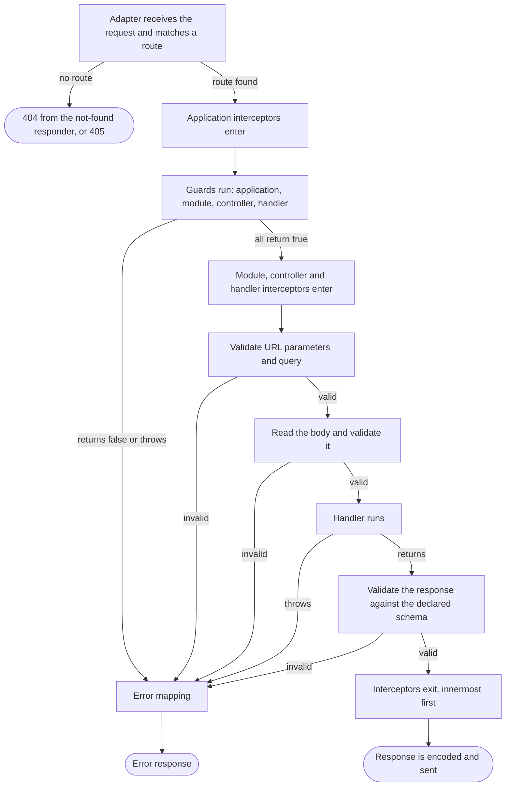

# How a request is handled

Every request to a Navios server goes through the same stages in the same order. This page is the one place that order is written down; the pages for [guards and interceptors](/docs/server/essentials/guards-and-interceptors), [controllers](/docs/server/essentials/controllers) and [errors](/docs/server/essentials/errors) describe each stage and refer back here.

## The pipeline

Read top to bottom, the stages are:

1. **Route match.** The adapter's router finds the route for the method and path. A request that matches nothing is answered by the [not-found responder](/docs/server/essentials/errors#responders), or with 405 when the path is served for other methods; no interceptor, guard or error mapper runs for it.
2. **Application interceptors enter.** Those added with `app.intercept` or by a plugin wrap everything below, so they also see a request that a guard denies.
3. **Guards.** Those of the application's `guards` option run first, then those of modules, the controller's and the handler's. The first guard that returns anything other than `true`, or throws, stops the request.
4. **Interceptors of the module, the controller and the handler enter**, in that order. They run only for what the guards let through, and can read what a guard has set.
5. **URL parameters and query.** They are validated against `urlParamsSchema` and `querySchema`, in that order, when the declaration has them. With a `cookiesSchema` the cookies are validated before the URL parameters, and with a `headersSchema` the headers after the query.
6. **Body.** The body is read, [decoded by its content type](/docs/server/essentials/controllers#request-bodies) and validated against `requestSchema`.
7. **Handler.** Your method runs with the validated values and the [request context](/docs/server/essentials/request-context).
8. **Response validation.** A JSON result is validated against the schema declared for its status. Fields the schema does not declare are removed.
9. **Interceptors exit.** Each interceptor receives the result on its way out, innermost first, and may change it.
10. **Encoding.** The result is serialised, with the headers and cookies set through `ctx.reply`, and the adapter writes it. A stream that fails before its first chunk fails here.

Anything thrown in stages 2 to 8 leaves the pipeline through the interceptors, which see it as an exception. That, and a result that stage 9 cannot encode, is turned into a response by [error mapping](/docs/server/essentials/errors#how-a-thrown-error-becomes-a-response).

After the response has been sent, or the client has gone away, what produces a streamed body is closed, the callbacks registered with [`ctx.onFinish`](/docs/server/essentials/request-context#when-the-response-has-finished) run and per-request state is disposed, in that order.

## What follows from the order

**Guards run before the body is read.** An unauthenticated request is rejected without its body being parsed. A request with both a missing credential and an invalid body gets the guard's answer, typically 401, not a 400.

**Guards see raw input.** Validation comes after guards, so a guard reads `ctx.urlParams` and `ctx.query` as the strings the client sent, and of the body no more than its [bytes](/docs/server/essentials/request-context#the-raw-body). The validated values exist only in the handler's first argument.

**Interceptors see errors as exceptions.** Error mapping happens after the outermost interceptor has exited. Inside an interceptor, a failed request is a rejected `next()`, never a result with a 4xx or 5xx status.

**Interceptors see the validated body, not bytes.** On the way out, a JSON result is still an object. Serialisation comes last.

**A failed response validation is the server's fault.** It becomes a 500, not a 400, and is logged in full.

## What is decided at start-up

The pipeline above is not interpreted per request. During [`init()`](/docs/server/essentials/application#what-init-does) Navios creates every controller, guard and interceptor once, and compiles one function per route that contains only the stages that route uses. A route with no guards, no interceptors and no request schemas is a call to the handler followed by response handling.

Two consequences:

- Controllers, guards and interceptors are singletons. Per-request data belongs in the request context, not in a field. See [Per-request state](/docs/server/guides/request-state).
- Mistakes in the route table surface when the application starts, not when a request arrives. See [Route rules checked at start-up](/docs/server/essentials/controllers#route-rules-checked-at-start-up).

## The same on every adapter

Stages 2 to 9 are implemented in `@navios/server`. An adapter only matches routes, hands the request and the bytes of its body over and writes the encoded response, so the order and the error responses are identical on [Fastify](/docs/server/adapters/fastify), [Bun](/docs/server/adapters/bun) and the in-memory adapter used in [tests](/docs/server/essentials/testing).
